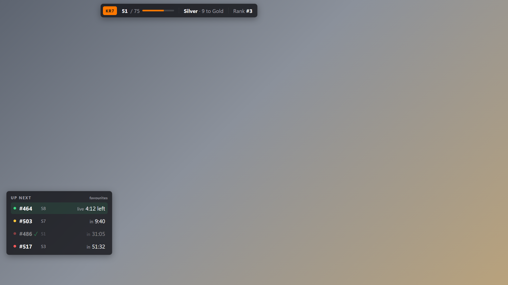
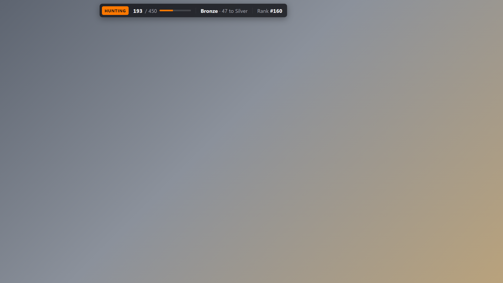
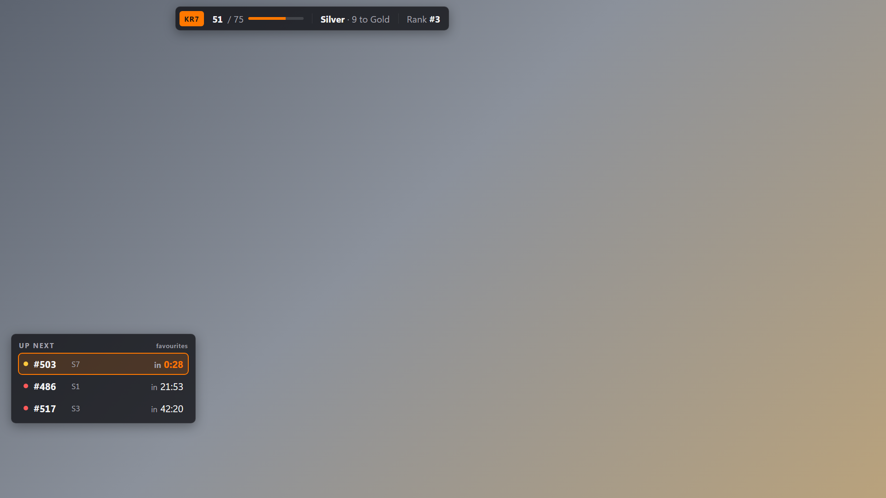
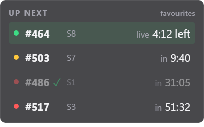
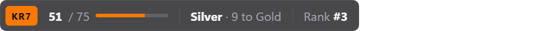
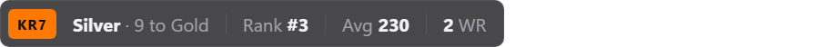
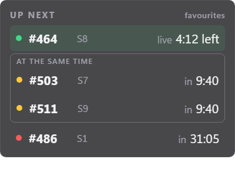

# Streamer Overlay Spec

Status: **Proposal** for [#1](https://github.com/kacky-code/kacky-live/issues/1). Replaces the original
five-widget wireframe.

Checked against the production API and KackyGG `dev` on 2026-11-07, during the live phase of
Kacky Reloaded 7 (event `26`). Revised on 2026-11-08 after the first review.

## 1. Context & Surface

- **Target surface:** OBS browser source, `1920x1080`, transparent background. Later the same data
  feeds a Twitch panel (Phase 2).
- **Audience:** Viewers of one streamer. The overlay answers what chat asks most: *when is the
  streamer's map up?* and *how far are they?*
- **Not in scope:** Current map, top 5 records, linked servers and donors. Kontrol already shows
  them in game, next to where this overlay would sit.

### Why favourites drive it

A streamer focuses on a handful of maps at a time. With 25 maps left, a list of every unfinished
map is noise. Competitive players pick a rotation of maps they like and whose slots line up, and
mark them as favourites in game (Kontrol). Maps they are not currently trying usually stay
unmarked, so the favourites *are* the rotation.

Kontrol stores a marker type with each favourite (`generic`, `easy`, `medium`, `hard`,
`impossible`), but streamers use them loosely: some only use `generic`, others use a marker for
"luck maps" or a heart for maps they like. The type says nothing reliable about difficulty, so the
overlay shows **every** favourite and never filters by type. The streamer configures nothing
beyond marking maps in game.

### Event phases

| Phase | Example | Overlay |
|---|---|---|
| Live edition | KR7, `id 26`, type `KR` | Stats + up next |
| Hunting | KR hunting `id 99` (`KRHX`), KX hunting `id 200` (`KXHX`) | Stats for the hunting event. No up next: hunting servers have every map of the family and are jukeboxed only 0–3 maps ahead, so there is no schedule to show. |

The overlay never assumes a server count (it changes during an edition, e.g. 15 early, 10 later)
and never hardcodes an event id.

**Which event the stats use**, first match wins:

1. The streamer is on a public server: that server's `eventId` (`serverLogin` on
   `GET /players/{id}`, then the row in `GET /servers/live`). This picks the edition or the right
   hunting event by itself. KackyGG sets `serverLogin` on `player.connect` for every server and
   clears it on `player.disconnect`. A crashed server can leave it stale, so a server missing from
   `/servers/live` does not count.
2. A live edition is running: `GET /events/active`.
3. Otherwise the active hunting event of `family` (default `KR`): the active event of type
   `{family}HX` in `GET /events`. Editions point to it through `contributesToEventId`.

### Placement

There is no layout that fits every streamer. Some have their camera top right, some top left;
some keep chat on the left, some on the right; some moved Kontrol's HUD, some did not. So the
overlay does not pick a layout. Each widget has its own URL (`?widget=schedule`,
`?widget=progress`, see 4) and becomes its own browser source, which the streamer positions and
scales in OBS on its own. Widgets are designed to look right at 1080p.

Without `widget`, the page shows both widgets on one transparent `1920x1080` layer, for streamers
happy with the default layout.

Why not one URL and OBS cropping: OBS can show the same browser source twice, each copy cropped
to one widget (*Add → Existing*, then crop with Alt+drag). But the widgets change size (the strip
is shorter in hunting, the list follows the number of favourites), so a crop either cuts content
or needs slack, and few streamers know the feature. One URL per widget is what streamers already
do for alerts and chat.

## 2. Widgets

### Up next

The streamer's favourite maps on the live edition servers, soonest first, at most `count`.

```text
+------------------------------+
| UP NEXT                      |
| #464  S8   live · 4:12 left  |
| #503  S7   in 9:40           |
| #486  S1   in 31:05          |
+------------------------------+
```

- One row per map: map number, server tag, state and time.
- States: **live** (time left), **next** on its server, **later** (time until start).
- A row without a time shows `next` or `3 maps away`. That happens when the server's timing is
  unknown or stale: KackyGG gives no forecast rather than a wrong one (see 3.2).
- **Finished favourites** stay listed but dimmed, with a ✓. Players usually unfav a map once they
  finish it (Kontrol has `/unfav finished`), so a finished favourite stays visible until the
  streamer removes it.
- **Favourites at the same time** are boxed together under "at the same time" (proposal, see Open
  Questions). Servers in one sync group switch maps at the same moment, so two favourites on two
  servers of a group often start together. Two rows count as the same time when their `startsAt`
  (or, for live maps, `endsAt`) differ by less than 60 s.
- No favourite on any server → widget hidden.

### Stats strip

```text
KR7      51 / 75 ━━━━━━━━━━   Silver · 9 to Gold   Rank #3   Avg 230
HUNTING  193 / 450 ━━━━━━━━   Bronze · 47 to Silver   Rank #160   Avg 139
```

A badge with the event (`KR7`, `HUNTING`), then the stats the streamer picks, in the order they
pick them (`stats=`, see 4). All of them are for the event chosen in 1 (Event phases):

| Stat | Shows | Source |
|---|---|---|
| `progress` | Finished maps of the event, with a bar | `mapBreakdown.progress.completed` / `.total` |
| `milestone` | Current tier and finishes to the next one | `mapBreakdown.progress.currentTier` and `.thresholds` |
| `rank` | Leaderboard position | `rank` in the leaderboard |
| `avg` | Average rank on finished maps (to confirm, see Open Questions) | `averageRankFinishedMaps` in the leaderboard |
| `wr` | World records | `worldRecords` in the leaderboard |

- Default: `progress,milestone,rank`.
- **Milestones** are the tiers Plastic, Bronze, Silver, Gold and Kacky. Their thresholds depend on
  the event's map count (KR7: 10 / 25 / 40 / 60 / 75; KR hunting: 60 / 140 / 240 / 360 / 450) and
  always come from the API. At the top tier the stat shows the tier alone.
- Overall finishes across all events are not shown: they mean little on stream.

### Mockup

Rendered from [`mockup/overlay.html`](mockup/overlay.html) (`?state=live|hunting|alert|overlap`)
with illustrative numbers. The page is transparent; the grey backdrop only stands in for the game.

**Live edition:** stats strip and up next. `#486` is already finished, so it is dimmed.



**Hunting:** stats for the hunting event, no schedule.



**Alert (later):** a favourite 30 s from starting.



**One widget per browser source** (`?widget=schedule` at 400 × 250, `?widget=progress` at
900 × 52, transparent as OBS gets them):





**Custom stats:** `?widget=progress&stats=milestone,rank,avg,wr`



**Favourites at the same time (proposal, for discussion):** `#503` on S7 and `#511` on S9 start
together, so they share a box.



## 3. Data

### 3.1 Public endpoints (no key)

| Data | Endpoint | Fields | Poll |
|---|---|---|---|
| Streamer's server | `GET /players/{id}`, `GET /servers/live` | `serverLogin`; the server's `eventId` | 20 s |
| Active edition | `GET /events/active` | `id`, `name`, `eventType` | 60 s |
| Hunting event | `GET /events` | active event of type `{family}HX` | 60 s |
| Progress, milestones | `GET /players/{id}/stats?eventId={id}&includeMapBreakdown=true` | `mapBreakdown.progress` | 60 s |
| Rank, avg, WRs | `GET /leaderboard?eventId={id}&search={nickname}` | the row whose `playerId` matches | 60 s |

The leaderboard search matches names, so it can return more than one row; the overlay keeps the
one with the streamer's `playerId`.

### 3.2 New endpoint (KackyGG, keyed)

The streamer's favourites are private. Their schedule comes from KackyGG's `ServerSchedule`, which
shipped on `main` with the `!nextmaps` and `!when` chat commands (KackyGG #287) and which streamers
already use. It reads every edition server's full playlist from kontrol (`server.sync`) and
forecasts when each map plays. Favourites themselves are stored in KackyGG: kontrol's `/fav` and
`/unfav` write them through `POST`/`DELETE /favorites/{login}`.

**Edition servers only.** `ServerSchedule` leaves hunting servers out on purpose: they hold every
map of the family and are jukeboxed only 0–3 maps ahead, so their playlist says nothing about
what plays when. During hunting the endpoint returns `edition: null` with no maps, and Up next
stays hidden.

The endpoint reuses `ServerSchedule` as it is, with no timing logic of its own:

- **Known timing bugs:** extend votes inflate queued maps, and a failed `server.sync` looks like an
  empty answer. The planned fix (KackyGG `.agents/handoffs/next-maps-timing.md`) forecasts synced
  servers from their schedule clock and drops stale data. Because the endpoint shares the code,
  that fix corrects the overlay too. Until then the overlay shows what `!nextmaps` shows.
- **Stale data:** the fix's rule is *"stale data gives no forecast, never a wrong time."* The
  endpoint passes that through as `startsAt: null`, and the overlay shows the row without a time.

```text
GET /v1/overlay/nextmaps?count=4
X-Api-Key: kgg_...
```

| Query | Default | Rule |
|---|---|---|
| `count` | `4` | 1–10 |

All favourite types are included. Unlike `!nextmaps`, there is no type filter.

```jsonc
{
  "generatedAt": "2026-11-07T14:40:00Z",   // server clock, for client skew
  "edition": { "eventId": 26, "name": "Kacky Reloaded 7" },   // null between editions and in hunting
  "maps": [
    {
      "mapNumber": 464,
      "mapUid": "…",
      "favoriteType": "generic",  // the streamer's marker, passed through, never filtered
      "marker": { "icon": "♦", "color": "fff" },   // later, see Later: Marker icon
      "finished": false,          // the streamer has an online finish on this map → row dimmed
      "family": "KR",
      "server": { "login": "…", "tag": "S8" },
      "state": "live",            // live | next | later
      "position": -1,             // -1 live, 0 next, 1+ later
      "startsAt": null,           // estimated; null when live, unknown or stale
      "endsAt": "2026-11-07T14:44:12Z"
    }
  ]
}
```

- Times are absolute, so the client counts down locally between polls. Poll every 20 s.
- **Key:** a new read-only streamer key with scope `overlay:read`, made on the kacky.gg profile
  next to the chat key. It can read only its owner's favourites and schedule. The chat key
  (`clips:write`) is not accepted.
- **CORS:** the overlay origin is added to the API's allowed origins (`Cors:OverlayUrl`). Closes
  [#9](https://github.com/kacky-code/kacky-live/issues/9).

## 4. URL

```text
/overlay?widget=schedule&player=842#key=kgg_...   → Up next
/overlay?widget=progress&player=842&stats=progress,milestone,rank   → Stats strip, no key
/overlay?player=842#key=kgg_...                   → both, on the full 1920x1080 layer
```

| Param | Required | Default | Rule |
|---|---|---|---|
| `widget` | no | both | `schedule` or `progress`. Unknown value → transparent page |
| `player` | yes | – | KackyGG player id, picked on `/config` by name or login |
| `count` | no | `4` | 1–10. Rarely needed; the default fits the panel |
| `stats` | no | `progress,milestone,rank` | Stats strip content and order, from `progress`, `milestone`, `rank`, `avg`, `wr`. Unknown names are skipped |
| `family` | no | `KR` | Which hunting event to use when the streamer is not on a public server (`KR`, `KX`) |
| `key` (fragment) | no | – | Needed for `schedule` only. Without it, Up next stays hidden |

A single-widget page draws its widget in the top-left corner with no margin, so the browser
source can be sized to it. Recommended OBS browser source sizes:

| Widget | Width × height | Notes |
|---|---|---|
| `schedule` | `400 × 250` | Fits the default 4 rows; add about 48 px per extra row |
| `progress` | `900 × 52` | The strip is left-aligned; its width follows the chosen stats |
| both | `1920 × 1080` | |

The `/config` page ([#10](https://github.com/kacky-code/kacky-live/issues/10)) generates both URLs,
offers the stats as checkboxes the streamer can reorder, and shows these sizes next to them.

The key sits in the URL fragment, so browsers never send it to the overlay host. OBS loads the
page without the key. The page's JavaScript then reads it from `location.hash` and calls the API
with `fetch()`, putting the key in the `X-Api-Key` header. OBS needs no header setting for this:
the browser source is Chromium, and the page makes the API call itself. The key still sits in the
OBS settings, which is why it is read-only.

## 5. Formatting

- **Names:** Strip Trackmania codes from event names and nicknames: colours `$rgb` (1–3 hex
  digits), styles `$o $i $w $n $t $s $g $z $m`, links `$l[...]`/`$h[...]`, `$$` → `$`.
- **Nicknames:** The game shows `customNickname` (e.g. `Worel` for `TheWoreL`). Show it stripped,
  fall back to `nickname`.
- **Times:** `m:ss`, `h:mm:ss` past an hour, as the chat commands do.
- **Nothing the game defines is hardcoded.** Event ids, milestone tiers and thresholds, marker
  icons and colours all change, so they come from the API. The overlay only knows the names it
  displays them by.
- **Visuals:** Dark translucent panels, tabular numerals, no motion except the value changes.

## 6. UI States & Fallbacks

| State | Up next | Stats strip |
|---|---|---|
| Loading | Hidden | Hidden |
| Error / offline | Keep last good, keep counting down | Keep last good |
| No key / bad key | Hidden | Shown |
| Hunting | Hidden | Hunting event stats |
| No event found | Hidden | Hidden |
| No favourite on a server | Hidden | Shown |
| 5 min without a good response | Hidden | Hidden |

Never render error text, status codes or stack traces.

## 7. Acceptance & Testing

- Renders at 1920x1080 in OBS with no scrollbars and a transparent background.
- Countdowns stay right across a 2-minute network outage and resync after.
- Unit tests: name stripping (incl. `$$`), time format, fallback states, countdown from `endsAt`,
  dimmed finished rows, same-time grouping (incl. the 60 s edge), rows without a time, event
  choice (server, edition, hunting family), `stats=` parsing and order, milestone at the top tier.
- The key never appears in a request to the overlay host.

## Later

- **Alert:** a row flashes once when its map is 30 s from starting.
- **Marker icon:** show the streamer's own Kontrol marker next to a row, as a personal touch for
  viewers. Display only, never a filter. Icons and colours change, so the endpoint delivers them
  (`marker`) and the overlay never hardcodes them. Today they only exist in Kontrol's code
  (`plugins/api/utils.ts`, e.g. ♦ for `generic`, ♥ for `hard`), so KackyGG needs a source for them
  first. Decided when the feature is picked up.
- **Twitch panel:** the same data for viewers below the stream.

## Open Questions

1. **One URL per widget:** Is `?widget=schedule` / `?widget=progress` the right split, and should
   the combined page stay? Streamer layouts differ too much for one fixed layout (see 1,
   Placement).
2. **Favourites at the same time:** Is a shared box under "at the same time" the right way to show
   them (see the mockup)? Alternatives: order only, or a small marker on each row. The question
   is how often streamers hit it, and whether viewers need the hint at all.
3. **Which average:** Is `avg` the average rank on finished maps (`averageRankFinishedMaps`), or
   the average time (`average` in `/players/{id}/stats`)?
4. **Hunting family:** Is `family=KR` as default right, and is the server-first rule enough to
   pick KX hunting for streamers who hunt KX?
